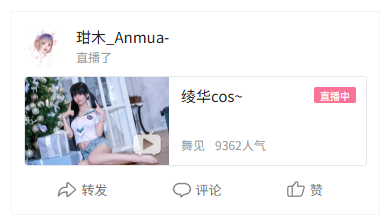

# TV UP 空间动态卡片 需求与设计

> 目标端：Android TV（`app/tv`）
> 数据源：`/x/polymer/web-dynamic/v1/feed/space`（空间动态专用端点）
> 状态：v2，待评审
> 关联文档：[TV UP 空间页改造设计](./2026-11-10-tv-up-space-redesign-design.md)

## 0. 修订记录

| 版本 | 变更 |
|---|---|
| v1 | 首版：2 列网格、图文九宫格、卡片头右侧类型角标 |
| v2 | 动态 tab 改为 **3 列瀑布流**；图文**最多 3 图**，超出时第 3 张右下角显示 `+(n-3)张`；视频时长固定**右下角**；明确卡片内**没有关注按钮**；头部副标题在 `pub_time` 之后拼 `pub_action` |
| v3 | 瀑布流焦点改为**按 index 强行分行**（`RowAlignedGridFocus`），不再依赖几何最近邻；补充 UP 空间动态加载失败的根因与修复（见 6.13） |
| v4 | 空间动态端点由 `/feed/all` 改为 `/feed/space`：`/feed/all` 是关注流，未关注的 UP 拿不到数据；`/feed/all` 仅保留给首页「动态」页 |
| v5 | **删除定制的行对齐焦点**：实测「按 DOWN 焦点卡住」且手感迟滞，动态 tab 改回 Compose 默认的几何焦点搜索 |
| v6 | 只接管 UP/DOWN 做**同列移动**（`DynamicGridFocus`），左右仍用默认搜索；动态 tab 常驻紧凑头部 + 媒体区高度按视口反推，解决「卡片显示不全」 |
| v7 | 视频描述为 `-` / `—` / `…` 等占位符（B 站空描述的实际下发值）时整行不显示（`isPlaceholderText`） |
| v8 | 动态 tab 由 3 列改为 **4 列**瀑布流（3 列时卡宽过大）；直播卡改为封面在上、信息在下，适配窄卡 |
| v9 | 充电专属卡改纵向排布（按钮单独一行靠右），修复窄卡下文字被挤成竖排；转发理由最多 2 行；聚焦卡被截断时上下键只滚动半屏、不换焦点 |
| v10 | 直播动态详情页补上直播卡片（此前详情页没有 live 分支），可直达直播间 |
| v11 | 修正上下键在边界处吞键：首行按 UP 交回默认焦点搜索（回到 tab 栏），列表末尾按 DOWN 同理 |
| v12 | 聚焦卡被截断时的滚动量由「半屏」改为固定 **100dp**（`DynamicRevealScrollStep`） |
| v14 | 实现收敛（不改变卡片外观）：图文详情只请求**一个**接口（动态详情，含正文/图片/视频/收藏数）；五个列表的分页状态收敛为 `PagingState`；合集/系列详情移出主网格、头部固定，返回时按 key 滚动 + `requestFocusWithRetry` 复原焦点（删掉 `pendingFocusKey`/`pendingArchive` 的多轮重试）；删除无引用的 `DynamicVideoKind`、`VideoCardData.topRightBadge`、`dynamicMediaMaxHeight`、`FocusableImage`、`/opus/detail` 与 `/x/article/view` 整条链路 |
| v13 | 去掉媒体区高度上限（`dynamicMediaMaxHeight` / `DefaultMediaMaxHeight` / `SpaceDynamicCard.mediaMaxHeight`）：卡片高度不再随视口和聚焦状态变化；聚焦卡被截断时统一由上下键按**半屏**滚动揭示（`revealScrollStep`） |
| v15 | 新增**文章动态**（`DYNAMIC_TYPE_ARTICLE`）卡片：兼容旧版 `MAJOR_TYPE_ARTICLE`（`major.article`）与新版「投稿了文章」（`MAJOR_TYPE_OPUS`，`major.article` 为 `null`，内容在 `major.opus`）；卡片按图文排版渲染标题/正文/封面，角标改为「文章」，点击仍进动态详情（详情页提供「打开专栏」） |
| v16 | 图文详情页改用 `/x/polymer/web-dynamic/v1/opus/detail`（`features=htmlNewStyle`），**仍然只发一个请求**：动态详情接口的 `module_stat` 只有转发/评论/点赞，**没有 `favorite`**，收藏数一直显示 0；opus 详情一份响应就含正文/图片/附带视频、互动数（含收藏数与「我已收藏」状态）与评论 id。`ArticleViewData.fromOpusDetail` 负责映射，`ApiSign` 把该端点加入 wbi 签名列表 |

## 1. 背景与目标

TV 端 UP 空间页（`UpInfoActivity` → `UpInfoScreen`）的「动态」tab 目前使用 4 列网格，卡片只有「封面 + 一行标题 + 类型角标」。这在 TV 上能快速扫，但看不出动态到底在说什么：

- 图文动态只显示第一张图和一段被截断的文字，多图、长文全部丢失。
- 引用动态只显示转发理由，被引用的作者和内容完全看不到。
- 直播动态只有封面和标题，没有「直播中」状态、分区和人气。
- 充电专属动态只有一个图标和一句提示，没有接口下发的按钮文案。
- 所有卡片都没有转发/评论/点赞数，也没有头像行。

本期的目标：**在 TV 的 UP 空间动态 tab 里，用 4 列瀑布流承载接近网页端的完整社交卡片，呈现 5 类动态；整张卡片是唯一焦点，按 OK 进入对应详情页。** 不新增直播播放、支付、卡片内互动、关注等平台能力。

### 1.1 涉及卡片

| 动态类型 | `type` | 内容模块 | 截图 |
|---|---|---|---|
| 视频动态卡片 | `DYNAMIC_TYPE_AV` | `major.type = MAJOR_TYPE_ARCHIVE` | [01-av.png](#101-参考截图) |
| 直播动态卡片 | `DYNAMIC_TYPE_LIVE_RCMD` | `major.type = MAJOR_TYPE_LIVE_RCMD` | [02-live.png](#101-参考截图) |
| 图文动态卡片 | `DYNAMIC_TYPE_DRAW` | `major.type = MAJOR_TYPE_OPUS`（也可能下发 `MAJOR_TYPE_DRAW`） | [03-draw.png](#101-参考截图) |
| 文章动态卡片 | `DYNAMIC_TYPE_ARTICLE` | 旧版 `major.type = MAJOR_TYPE_ARTICLE`（`major.article`）；新版 `major.type = MAJOR_TYPE_OPUS`（`major.article = null`，内容在 `major.opus`） | [08-article.png](#101-参考截图) |
| 引用动态卡片 | `DYNAMIC_TYPE_FORWARD` | 外层无 major；被引用内容在 `orig` | [04-forward-draw.png](#101-参考截图)、[05-forward-video.png](#101-参考截图) |
| 充电专属图文卡片 | `DYNAMIC_TYPE_DRAW` + `major.type = MAJOR_TYPE_BLOCKED` | `major.blocked` | [07-blocked.png](#101-参考截图) |

## 2. 范围

### 2.1 本期范围

- `app/tv` 的 UP 空间页「动态」tab 的卡片渲染、布局、焦点和点击路由。
- `bili-api` 动态模型补齐直播与充电专属卡片需要的字段（只加字段，不改接口）。
- 卡片展示逻辑抽成纯函数，并补单元测试。

### 2.2 非目标

- **不改移动端**：移动端 UP 空间页（`UserSpaceScreen`）目前只有视频列表，没有动态 tab；本期不新增。
- **切换端点**：空间动态改用 `/x/polymer/web-dynamic/v1/feed/space`。
  `/feed/all` 是「关注的人」的动态流，即使带 `host_mid` 也只返回关注列表内的内容，未关注的 UP 会拿到空列表——这是「部分 UP 动态加载失败/空白」的第二个成因。`/feed/all` 仍是首页「动态」页的数据源，不动。
- **卡片内不做互动**：转发/评论/点赞栏只展示计数，按钮不可单独聚焦；点赞等操作仍进详情页完成（`DynamicDetailScreen` 已有点赞逻辑）。
- **不做卡片级关注按钮**：页面顶部已有 UP 关注按钮。
- **不做图片预览、视频预览、长按操作菜单**。
- **不做充电支付**：充电专属卡片只展示 CTA 文案，点击进动态详情。
- **不做直播播放**：动态列表的直播卡片点击进动态详情，不直接起播；详情页的直播卡片可以进直播间（见 6.14）。

## 3. 现状与差距

### 3.1 现有实现

| 位置 | 现状 |
|---|---|
| `app/tv/.../screens/user/UpSpaceCards.kt` | `SpaceDynamicCard`：视频类走 `SmallVideoCard`；其它类型走「单封面 + 单标题 + 类型角标 + `作者 · 时间`」 |
| `app/tv/.../screens/user/UpInfoScreen.kt` | 所有 tab 共用 `LazyVerticalGrid(columns = GridCells.Fixed(4))`；`currentIndex` 驱动标题收起；加载更多阈值 `index + 12 > size` |
| `bili-api/.../entity/user/Dynamic.kt` | `DynamicItem` 已能解析 AV / DRAW / FORWARD / LIVE_RCMD / BLOCKED / WORD / PGC / ARTICLE；`DynamicVideoModule` 已有 `playCount/danmakuCount/durationSeconds/badgeText` |
| `bili-api/.../repositories/UserRepository.kt` | `getDynamicsByUp()` 打 `/feed/all`（关注流的端点），`features = itemOpusStyle,listOnlyfans,opusBigCover,onlyfansVote` |
| `app/shared/.../viewmodel/user/UserSpaceViewModel.kt` | 动态分页、`mergePage` 去重、错误态都已具备 |

### 3.2 差距

| 卡片 | 现在能看到 | 缺口 |
|---|---|---|
| 视频 | 封面、标题、时长、播放、弹幕、角标 | 无头像行、无 UP 动作（投稿了视频）、无描述、无统计栏 |
| 直播 | 封面、标题 | 无「直播了」动作、无直播状态、无分区、无人气 |
| 图文 | 第一张图、一段文字 | 多图丢失、正文被截成一行、无图片数量提示 |
| 引用 | 转发理由 | 被引用作者、正文、图片/视频全部丢失 |
| 充电专属 | 图标、提示 | 无标题层级、无按钮文案、无背景图 |

## 4. 需求

### 4.1 功能需求

| ID | 需求 | 优先级 |
|---|---|---|
| FR-1 | 「动态」tab 改为 **4 列瀑布流**（`LazyVerticalStaggeredGrid`，卡片高度随内容变化）；「视频」「图文」「合集和系列」仍为 4 列网格 | P0 |
| FR-2 | 所有动态卡片都包含：头像、昵称、`发布时间 · 发布动作`、类型角标（直播用直播状态角标）、正文、媒体、统计栏；**卡片内不含关注按钮** | P0 |
| FR-3 | 视频动态：标题、16:10 封面（播放/弹幕在左下，**时长在右下**）、描述、统计；点击进视频详情 | P0 |
| FR-4 | 直播动态：封面、「直播中」状态、标题、分区、人气；点击进动态详情 | P0 |
| FR-5 | 图文动态：标题 + 正文（最多 5 行）+ **最多 3 张 1:1 图**；超过 3 张时第 3 张右下角显示 `+(n-3)张`；点击进图文详情 | P0 |
| FR-6 | 引用动态：转发理由 + 引用块（原作者、正文 3 行、最多 3 张图或 1 个视频封面）；点击进动态详情 | P0 |
| FR-7 | 充电专属：标题、提示、按钮文案（来自接口）；点击进动态详情 | P0 |
| FR-8 | 统计栏展示转发/评论/赞；`≥ 10000` 显示 `x.x万`，`0` 显示文字标签 | P1 |
| FR-9 | 整张卡片是唯一焦点；焦点态有背景提亮 + 描边；方向键在网格内正常移动 | P0 |
| FR-10 | 接近底部自动加载下一页；展示加载中、加载失败（可重试）、没有更多 | P0 |
| FR-11 | 点击路由与现有 `cardAction()` 保持一致：图文→`ArticleActivity`，视频→`VideoInfoActivity`（带 preloaded list），其余→`DynamicDetailActivity` | P0 |
| FR-12 | 空数据、首屏加载、错误态使用现有 `SpaceContentStatus`，在瀑布流中占满整行（`StaggeredGridItemSpan.FullLine`） | P1 |
| FR-13 | 头部副标题取 `module_author.pub_time`，其后拼接 `module_author.pub_action`；两者都用接口原值，不硬编码文案 | P0 |
| FR-14 | 文章动态：标题（加粗，2 行）+ 正文（3 行）+ 封面（与图文同一套图片规则）；角标「文章」；点击进动态详情 | P0 |

### 4.2 非功能需求

| ID | 需求 |
|---|---|
| NFR-1 | 单张卡片首帧不阻塞滚动；图片请求使用现有 `resizedImageUrl` 预设，避免按原图解码 |
| NFR-2 | 卡片正文和图片都设上限，单卡高度可控；4 列瀑布流下卡宽约 230dp，内容不能依赖更宽的空间 |
| NFR-3 | 不引入新的第三方依赖；复用 `CardCover`、`SmallVideoCard` 的视觉语言 |
| NFR-4 | 遥控器操作不出现「按返回没反应」；瀑布流的 `columnCount` 必须与焦点边界工具一致 |
| NFR-5 | 模型改动只增字段，保持现有 AV/DRAW/FORWARD 解析行为不变 |

### 4.3 验收场景

1. **视频动态**：进入动态 tab，卡片显示头像、昵称、「3天前 · 投稿了视频」、标题、封面（左下播放/弹幕，**右下时长**）、描述、统计栏；按 OK 进入视频详情。
2. **直播动态**：卡片显示「直播了」、封面、标题、「直播中」、分区与人气；按 OK 进入动态详情。
3. **图文 3 图**：正文最多 5 行，3 张 1:1 图一行铺满，**右下角不出现计数**；按 OK 进入图文详情。
4. **图文 7 图**：只渲染 3 张图，第 3 张右下角显示 `+4张`；按 OK 进入图文详情。
5. **引用图文**：显示转发理由 + 引用块（`@原作者`、正文 3 行、最多 3 张图，超出时第 3 张显示 `+(n-3)张`）；按 OK 进入动态详情。
6. **引用视频**：引用块显示视频封面与时长（右下）/播放/弹幕（左下），封面下一行显示原视频描述；按 OK 进入动态详情。
7. **充电专属**：显示标题、提示、「6元充电」按钮文案；按 OK 进入动态详情。
8. **分页**：滚动到倒数第 6 张时自动请求下一页；到底显示「没有更多内容」；失败显示错误与「重试」。
9. **焦点**：从 tab 栏按向下进入第一张卡；左右移动在同一行；焦点卡片有描边；切 tab 后回到顶部并聚焦 tab。
10. **无关注按钮**：任何动态卡片上都不出现「+关注」，关注入口只有页面顶部（与网页截图不同，这是 TV 端的既定取舍）。
11. **文章动态**：显示「1小时前 · 投稿了文章」、加粗标题、正文、封面（角标「文章」）；按 OK 进入动态详情，详情页可「打开专栏」。

## 5. 数据契约

### 5.1 请求

```http
GET /x/polymer/web-dynamic/v1/feed/space
  ?timezone_offset=-480
  &host_mid={upMid}
  &offset=
  &space_login_group=2
  &platform=web
  &features=itemOpusStyle,listOnlyfans,opusBigCover,onlyfansVote,forwardListHidden,decorationCard,commentsNewVersion,onlyfansAssetsV2,ugcDelete,onlyfansQaCard,avatarAutoTheme,sunflowerStyle,cardsEnhance,eva3CardOpus,eva3CardVideo,eva3CardComment,eva3CardUser
Cookie: SESSDATA=...; DedeUserID=...; DedeUserID__ckMd5=...
```

- 只按 `offset` 翻页：首屏 `offset=`（空串），之后填上一次响应的 `data.offset`。
- **不要**带 `page` / `type`：这两个是 `/feed/all` 的参数，`/feed/space` 不接受。
- `space_login_group=2`、`platform=web` 与网页端空间页一致；`features` 用网页端完整列表（缺项会让图文回退成旧结构、充电专属卡丢 `blocked.button`）。
- 该端点不需要 wbi 签名（网页端也未签名）；`ApiSign` 的 wbi 白名单不含它。

> 说明：`/feed/all` 仍然是首页「动态」页（关注流）的数据源，本次只把 UP 空间页切到 `/feed/space`。

### 5.2 通用字段

| 界面 | 字段 |
|---|---|
| 头像 | `modules.module_author.face` |
| 昵称 | `modules.module_author.name` |
| 头部副标题 | `modules.module_author.pub_time` + `modules.module_author.pub_action`（见 6.2） |
| 统计 | `modules.module_stat.forward.count`、`comment.count`、`like.count`、`like.status` |
| 动态 id / 评论 id | `id_str`、`basic.comment_id_str` |
| 动态类型 | `type`（`DYNAMIC_TYPE_*`）→ `DynamicItem.type` |
| 内容类型 | `modules.module_dynamic.major.type`（`MAJOR_TYPE_*`）→ `DynamicItem.majorType`；gRPC 接口没有该字段，此时为空 |
| 类型角标 | 由动态类型与内容模块推导，见 6.2 |

> `pub_time` 与 `pub_action` 都直接使用接口原值：`pub_time` 形如 `3天前`、`11月6日`、`9月4日`；`pub_action` 形如 `投稿了视频`、`直播了`，图文/引用/充电动态通常为空串。

### 5.3 视频动态（`DYNAMIC_TYPE_AV`）

```json
{
  "type": "DYNAMIC_TYPE_AV",
  "modules": {
    "module_author": {
      "name": "玵木_Anmua-",
      "face": "https://i1.hdslb.com/bfs/face/903208e5....jpg",
      "pub_time": "3天前",
      "pub_action": "投稿了视频"
    },
    "module_dynamic": {
      "major": {
        "type": "MAJOR_TYPE_ARCHIVE",
        "archive": {
          "aid": "117580786371059",
          "bvid": "BV1SJWJ6eEPM",
          "title": "怎么这个人天天素颜原皮？><",
          "desc": "怎么这个人天天素颜原皮？><",
          "cover": "http://i1.hdslb.com/bfs/archive/c6d559ea....jpg",
          "duration_text": "00:15",
          "badge": { "text": "投稿视频", "bg_color": "#FB7299", "color": "#FFFFFF" },
          "stat": { "play": "1.5万", "danmaku": "87" }
        }
      }
    },
    "module_stat": {
      "forward": { "count": 0 },
      "comment": { "count": 52 },
      "like": { "count": 2066 }
    }
  }
}
```

| 界面 | 映射 |
|---|---|
| 封面上方正文 | `bodyText`（`module_dynamic.desc.text`），最多 2 行；与 `video.title` 相同、为空或是 `-`/`…` 占位符时不显示 |
| 封面 | `video.cover`（`CardCover`，16:10） |
| 时长 | `video.duration` |
| 播放 / 弹幕 | `video.playCount`、`video.danmakuCount`（已有数值字段） |
| 封面下标题 | `video.title`，最多 2 行；**视频简介（`archive.desc` → `video.text`）不展示** |
| 角标 | `video.badgeText`；为空则不显示 |
| 点击 | `VideoInfoActivity`，preloaded list = 当前动态 tab 内所有视频 |

> 封面上方是**动态正文**，不是视频标题；封面下方是**视频标题**，不是简介。UP 投稿时 B 站常把标题原样塞进 `module_dynamic.desc`，两者相同就只在封面下方显示一次。

### 5.4 直播动态（`DYNAMIC_TYPE_LIVE_RCMD`）

`major.live_rcmd.content` 是 **JSON 字符串**，需要二次解析。

```json
{
  "type": "DYNAMIC_TYPE_LIVE_RCMD",
  "modules": {
    "module_author": { "name": "玵木_Anmua-", "pub_time": "", "pub_action": "直播了" },
    "module_dynamic": {
      "major": {
        "type": "MAJOR_TYPE_LIVE_RCMD",
        "live_rcmd": {
          "content": "{\"type\":1,\"live_play_info\":{\"room_id\":5215238,\"live_status\":1,\"title\":\"绫华cos~\",\"cover\":\"https://i0.hdslb.com/bfs/live/new_room_cover/66a9....jpg\",\"online\":8606,\"area_name\":\"舞见\",\"parent_area_name\":\"娱乐\",\"link\":\"//live.bilibili.com/5215238?live_from=85002\",\"watched_show\":{\"text_large\":\"1630人看过\"}}}"
        }
      }
    },
    "module_stat": { "forward": { "count": 0 }, "comment": { "count": 0 }, "like": { "count": 0 } }
  }
}
```

| 界面 | 映射 |
|---|---|
| 头部动作 | `author.pubAction`（`直播了`）；`pub_time` 为空 |
| 封面 | `liveRcmd.cover`（16:9，中央播放图标） |
| 标题 | `liveRcmd.title`，最多 2 行 |
| 状态 | `liveRcmd.liveStatus`：`1` → 直播中；`0` → 未开播；`2` → 轮播 |
| 分区 | `liveRcmd.areaName` |
| 人气 | `liveRcmd.online` → `8606 人气`；`online <= 0` 时用 `watchedText` |
| 点击 | `DynamicDetailActivity` |

**需要补的模型字段**（当前 `DynamicLiveRcmdModule` 只有 `title/cover/roomId`；新字段全部带默认值，避免破坏既有构造点）：

```kotlin
data class DynamicLiveRcmdModule(
    val title: String,
    val cover: String,
    val roomId: Int,
    val areaName: String = "",
    val parentAreaName: String = "",
    val online: Int = 0,
    val liveStatus: Int = 0,
    val watchedText: String = "",
    val link: String = ""
)
```

字段来源：`live_play_info.area_name`、`parent_area_name`、`online`、`live_status`、`watched_show.text_large`、`link`。

### 5.5 图文动态（`DYNAMIC_TYPE_DRAW`）

```json
{
  "type": "DYNAMIC_TYPE_DRAW",
  "modules": {
    "module_author": { "name": "玵木_Anmua-", "pub_time": "11月6日", "pub_action": "" },
    "module_dynamic": {
      "major": {
        "type": "MAJOR_TYPE_OPUS",
        "opus": {
          "title": " 或许私信说我丑的可以看看这个原相机无修版",
          "summary": { "text": "应该还能看看吧 ，投稿里也有原相机无拉腿的..." },
          "fold_action": ["展开", "收起"],
          "jump_url": "//www.bilibili.com/opus/1267444595680083989",
          "pics": [
            { "url": "http://i0.hdslb.com/bfs/new_dyn/live_07d1....jpg", "width": 4284, "height": 5712 },
            { "url": "http://i0.hdslb.com/bfs/new_dyn/live_047d....jpg", "width": 3024, "height": 4032 },
            { "url": "http://i0.hdslb.com/bfs/new_dyn/live_d758....jpg", "width": 2158, "height": 2954 }
          ]
        }
      }
    },
    "module_stat": { "forward": { "count": 3 }, "comment": { "count": 163 }, "like": { "count": 737 } }
  }
}
```

| 界面 | 映射 |
|---|---|
| 标题 | `draw.title`（`opus.title`），可空；最多 2 行，加粗 |
| 正文 | `draw.text`（`opus.summary.text`），最多 3 行 |
| 标题去重 | `draw.title` 为空、或 `draw.text` 已包含标题时，只渲染正文 |
| 图片 | `draw.images`（`opus.pics` 或 `major.draw.items`） |
| 附带视频 | `major.additional.ugc` → `video`（标题/封面/`duration`/`stat` 里的播放与弹幕）；渲染在图片行下方 |
| 正文占位 | 附带视频时正文里的 `视频：BVxxxx` 是视频卡占位，渲染前剥掉 |
| 点击 | `ArticleActivity`（图文详情） |

> 当前解析器已经同时支持 `MAJOR_TYPE_OPUS` 和 `MAJOR_TYPE_DRAW`。图片优先取 `major.draw.items`，其次 `opus.pics`；`opus.pics` 为空时回退到 `summary.rich_text_nodes[].pics/dyn_pic`（少数图文只把图放在富文本节点里），**不合并**——视频节点的 `pics` 是视频封面，合并会多出一张图。

### 5.6 引用动态（`DYNAMIC_TYPE_FORWARD`）

```json
{
  "type": "DYNAMIC_TYPE_FORWARD",
  "modules": {
    "module_author": { "name": "玵木_Anmua-", "pub_time": "9月7日", "pub_action": "" },
    "module_dynamic": { "desc": { "text": "周末快乐哇！26.27 两天木木都在～..." } },
    "module_stat": { "forward": { "count": 1 }, "comment": { "count": 4 }, "like": { "count": 165 } }
  },
  "orig": {
    "type": "DYNAMIC_TYPE_DRAW",
    "modules": {
      "module_author": { "name": "上海世界树漫展" },
      "module_dynamic": {
        "major": {
          "type": "MAJOR_TYPE_OPUS",
          "opus": { "summary": { "text": "嘉宾公布｜玵木_Anmua- 确认出席异世界嘉年华2.0！..." }, "pics": ["..."] }
        }
      }
    }
  }
}
```

| 界面 | 映射 |
|---|---|
| 转发理由 | `word.text`（`module_dynamic.desc.text`），最多 2 行 |
| 引用块作者 | `orig.author.author`，显示为 `@昵称` |
| 引用块正文 | `orig.draw.title/text` → `orig.word.text` → `orig.bodyText` 依次取第一个非空，最多 3 行；**视频标题/简介不放在这里** |
| 引用块视频标题 | `orig.video.title`，显示在视频封面**下方**；与引用正文相同时不重复 |
| 引用块媒体 | `orig.draw.images` → 最多 3 张 1:1 图，`n > 3` 时第 3 张右下角显示 `+(n-3)张`；`orig.video`（含 `additional.ugc`）→ 见下 |
| 源已删除 | `orig == null`（现有过滤器会整条丢弃，不会走到 UI） |
| 点击 | `DynamicDetailActivity` |

引用视频样例（`05-forward-video.png`）：`orig.type = DYNAMIC_TYPE_AV`，引用块内用 `CardCover` 显示原视频封面、时长、播放、弹幕；**视频标题显示在封面下方**，原动态若有自己的配文（`orig.bodyText`）则放在封面上方，视频简介不展示。

引用图文带视频样例（`04-forward-draw_has_video.png`）：`orig.type = DYNAMIC_TYPE_DRAW`，`major.opus` 里有图，同时 `module_dynamic.additional.type = ADDITIONAL_TYPE_UGC` 挂了一个视频：

```json
"additional": {
  "type": "ADDITIONAL_TYPE_UGC",
  "ugc": {
    "title": "挑战全网最还原🔥鸣潮女团《Shine Together》！",
    "desc_second": "4.1万观看 53弹幕",
    "jump_url": "//www.bilibili.com/video/BV15hWX6KE7C",
    "cover": "http://i0.hdslb.com/bfs/archive/164dc357e0d9c5e453c07d0e707c6586f1fe7866.jpg",
    "duration": "02:50",
    "stat": { "danmaku": "53", "play": "4.1万" }
  }
}
```

- `additional.ugc` 会映射成 `orig.video`，与 `orig.draw.images` **并存**：图片是主体，视频缩成「左缩略图 + 右标题/播放弹幕」的小卡（见 6.6）。
- **`desc_second` 是「4.1万观看 53弹幕」这类统计文案，不是时长**。旧实现把它当 `duration` 喂给 `convertStringTimeToSeconds`，解析时抛 `IndexOutOfBoundsException`，整条转发动态被 `runCatching` 丢弃，于是这类卡片在列表里整张消失。时长取 `duration`，播放/弹幕取 `stat`。
- `convertStringTimeToSeconds` 对无法解析的输入返回 `0`，不再抛异常。

### 5.7 充电专属图文（`DYNAMIC_TYPE_DRAW` + `MAJOR_TYPE_BLOCKED`）

```json
{
  "type": "DYNAMIC_TYPE_DRAW",
  "modules": {
    "module_author": { "name": "早上好七七", "pub_time": "3天前", "pub_action": "" },
    "module_dynamic": {
      "major": {
        "type": "MAJOR_TYPE_BLOCKED",
        "blocked": {
          "blocked_type": 3,
          "bg_img": { "img_day": "https://i0.hdslb.com/bfs/activity-plat/.../SKx66iAKxP.png" },
          "icon": { "img_day": "https://i0.hdslb.com/bfs/activity-plat/.../ZA8c60qRzh.png" },
          "title": "开通可看专属自拍专属动态",
          "hint_message": "加入当前UP主的「6元档包月充电」即可解锁观看",
          "button": { "text": "6元充电", "jump_url": "https://www.bilibili.com/h5/upower/index?..." }
        }
      }
    },
    "module_stat": { "forward": { "count": 0 }, "comment": { "count": 2 }, "like": { "count": 0 } }
  }
}
```

| 界面 | 映射 |
|---|---|
| 标题 | `blocked.title`（空时用 `hintMessage`，再空用 `充电专属动态`） |
| 提示 | `blocked.hintMessage` |
| 图标 | `blocked.iconUrl`（已有，dark 优先） |
| 背景 | `blocked.bgImageUrl`（新增） |
| 按钮 | `blocked.buttonText`（新增，`button.text`） |
| 点击 | `DynamicDetailActivity`（按钮不单独响应） |

**需要补的模型字段**（当前 `DynamicBlockedModule` 只有 `title/hintMessage/iconUrl`；同样全部带默认值）：

```kotlin
data class DynamicBlockedModule(
    val title: String,
    val hintMessage: String,
    val iconUrl: String,
    val bgImageUrl: String = "",
    val buttonText: String = "",
    val jumpUrl: String = ""
)
```

`fromModuleBlocked` / `fromModuleDynamic` 映射时补齐；`fromModuleDynamic` 的 `major.type == MAJOR_TYPE_BLOCKED` 兜底逻辑保持不变。

### 5.8 文章动态（`DYNAMIC_TYPE_ARTICLE`）

文章动态有两种载荷，必须都支持：

| 载荷 | 判据 | 内容位置 |
|---|---|---|
| 旧版专栏 | `major.type = MAJOR_TYPE_ARTICLE` | `major.article.{title,desc,covers,jump_url,label}` |
| 新版「投稿了文章」 | `major.type = MAJOR_TYPE_OPUS`，`major.article = null` | `major.opus.{title,summary.text,pics,jump_url}` |

样例（来自 `assets/2026-11-12-up-space-dynamic-cards/data.json` 的「文章动态」，字段已裁剪）：

```json
{
  "id_str": "1270363713172406309",
  "type": "DYNAMIC_TYPE_ARTICLE",
  "basic": {
    "rid_str": "53842372",
    "comment_type": 12,
    "comment_id_str": "53842372",
    "jump_url": "//www.bilibili.com/opus/1270363713172406309"
  },
  "modules": {
    "module_author": { "name": "up", "face": "...", "pub_time": "1小时前", "pub_action": "投稿了文章" },
    "module_dynamic": {
      "desc": null,
      "major": {
        "type": "MAJOR_TYPE_OPUS",
        "article": null,
        "opus": {
          "jump_url": "//www.bilibili.com/opus/1270363713172406309",
          "title": "美团/淘宝APP闪购嗖：233233，直接领29-20神券，亲测有效",
          "summary": { "text": "B站这个密令靠谱，我自己用好久了\n现在还时不时发个大红包，经常点外卖的，\n用这个密令越用越大！\n美团/淘宝APP闪购嗖：233233\n[图片]" },
          "pics": [{ "url": "http://i0.hdslb.com/bfs/new_dyn/5b449b93....png", "width": 1078, "height": 606 }]
        }
      }
    },
    "module_stat": { "forward": { "count": 0 }, "comment": { "count": 0 }, "like": { "count": 41 } }
  },
  "orig": null
}
```

| 界面 | 映射 |
|---|---|
| 标题 | `draw.title`（新版取自 `opus.title`，旧版取自 `article.title`），可空；2 行、加粗 |
| 正文 | `draw.text`（新版取自 `opus.summary.text`，旧版取自 `article.desc`）；与标题重复时只保留正文 |
| 封面 | 新版 `opus.pics`（解析为 `draw.images`，沿用富文本节点兜底）；旧版 `article.covers` |
| 角标 | 固定「文章」（不压原来图文的「图文」） |
| 点击 | `DynamicDetailActivity`；即使附带视频（`additional.ugc`）也不进视频详情 |

**解析约定（`bili-api`）**：

- 旧版：`major.article != null` → `DynamicArticleModule.fromModuleArticle`。
- 新版：`major.article == null` → 用 `DynamicDrawModule.fromModuleDynamic` 把 `major.opus` 映射成 `draw`（标题/正文/图片），再用 `DynamicArticleModule.fromOpus(draw, opus.jump_url)` 同步填一份 `article`。移动端按 `dynamicItem.article!!` 渲染，`article` 必须非空。
- 两种载荷都没有内容时仍保留 `article`（正文退回 `module_dynamic.desc.text`），卡片降级为「只有正文」，不丢整条动态。
- gRPC：`dyn_article` 缺失时用 `module_opus_summary` + `module_dynamic` 组 `draw`/`article`，封面在 `ModuleOpusSummary.covers` 时也兜底。

> `article.url` 只用于详情页的「打开专栏」；新版是 `/opus/{动态id}` 链接，旧版是 `/read/cv{id}`。

## 6. 设计

### 6.1 页面结构与列数

```
UpInfoActivity
└── UpInfoScreen
    ├── 顶部 UP 信息（现有；关注按钮只在这里）
    ├── TopNav 胶囊 tab（现有）
    └── 内容区（按 tab 分支）
        ├── Dynamics  → LazyVerticalStaggeredGrid(StaggeredGridCells.Fixed(4))
        │                 └── SpaceDynamicCard（本期重写，卡片高度随内容变化）
        └── 其他 tab   → LazyVerticalGrid(GridCells.Fixed(4))（现有，不改）
```

- **动态 tab 用 4 列瀑布流**：与其余 tab 的列数一致，卡宽约 230dp。曾用 3 列（卡宽约 300dp），真机上卡片偏大、单屏信息量太少，改为 4 列。瀑布流让高卡片（多图/长文）只多占一列的高度，不会像等高网格那样留下大片空白。
- **不能直接复用 `LazyVerticalGrid`**：`LazyVerticalGrid` 的行高由整行最高的 item 决定，改成多列只会得到等高的大格子，和「瀑布流」不是一回事。因此动态 tab 单独用 `LazyVerticalStaggeredGrid`。
- 两套容器共用同一个内容区 modifier：`focusRestorer()`、Back 拦截、`ProvideListBringIntoViewSpec(padding = 24.dp)`。抽成一个局部 `val gridModifier` 避免两处漂移。
- 状态：保留现有 `lazyGridState: LazyGridState`；为动态 tab 新增 `dynamicGridState: LazyStaggeredGridState`。切 tab 的 `scrollToItem(0)` 按当前容器分发；合集/系列的 `pendingFocusKey` 焦点恢复只作用于 `LazyVerticalGrid`。
- 列数常量 `dynamicColumns = 3`，同时传给 `blockDownFocusExitAtGridEnd(columnCount = ...)` 与 `gridFocusItemCount(columnCount = ...)`；其他 tab 继续用 4。
- 参数：`columns = StaggeredGridCells.Fixed(4)`、`contentPadding = PaddingValues(24.dp)`、`verticalItemSpacing = 24.dp`、`horizontalArrangement = Arrangement.spacedBy(24.dp)`。
- 整行状态项用 `item(span = { StaggeredGridItemSpan.FullLine })`（`LazyVerticalGrid` 的 `GridItemSpan(maxLineSpan)` 在 staggered grid 里不存在）。
- `gridItemCount` 已按 `selectedTab` 分支，保持现状。

### 6.2 卡片通用骨架

> 下面按 4 列瀑布流下单卡约 230dp 宽绘制。

```
┌──────────────────────────────┐
│ ◯ 昵称                       │
│   发布时间 · 发布动作         │
│                              │
│ 正文标题 / 转发理由（2~5 行） │
│                              │
│ ┌──────────────────────────┐ │
│ │ 媒体区域                 │ │
│ │                [类型角标]│ │
│ └──────────────────────────┘ │
│                              │
│  ↪ 3     💬 163     👍 737   │
└──────────────────────────────┘
```

**容器**

- `Surface` + `ClickableSurfaceDefaults`，圆角 `MaterialTheme.shapes.medium`。
- 未聚焦：`containerColor = MaterialTheme.colorScheme.surfaceVariant.copy(alpha = 0.35f)`。
- 聚焦：`focusedContainerColor = onSurface.copy(alpha = 0.10f)`，`focusedBorder` 用 `onBackground.copy(alpha = 0.65f)`、2dp，与 `SmallVideoCard` 一致。
- 内边距 16dp；区块间距 12dp。
- 整卡一个 focusable；内部不嵌套可聚焦元素。

**卡片主体分发**（`cardBody()`）

| 顺序 | 判据 | 主体 |
|---|---|---|
| 1 | `blocked != null` | `Blocked`（充电专属）：外层类型可能是 DRAW/AV，内容类型才是 `MAJOR_TYPE_BLOCKED` |
| 2 | `type == FORWARD` | `Forward`：转发理由 + 引用块 |
| 3 | `type` 为 `DRAW` | `Draw`（缺 `draw` 内容时降级） |
| 3.5 | `type == ARTICLE` | `Article`：旧版 `article` 或新版 `draw` 存在即可；两者都缺时降级 |
| 4 | `type` 为 `AV`/`UGC_SEASON` | `Video`（缺 `video` 内容时降级） |
| 5 | `type == LIVE_RCMD` | `Live`（缺 `liveRcmd` 时降级） |
| 6 | 其它/未知 `type` | 按 `majorType`（`ARCHIVE`/`ARTICLE`/`OPUS`/`DRAW`/`LIVE_RCMD`/`LIVE`）判，再按实际存在的模块判 |

- **声明类型优先**：图文动态可能附带视频（`additional.ugc` → `video`），按模块是否存在来判会把附件当主体，正文和图片全丢。
- **降级**：期望模块缺失时（例如 `DYNAMIC_TYPE_AV` 没有 `archive`，正文被映射到 `word`）退回到「有正文出正文」，卡片降级而不是空白。
- 点击路由 `cardAction()` 与主体判定用同一套类型语义：`Draw`（非 blocked、id 可转 Long）→ 图文详情，有 `video` → 视频详情，其余 → 动态详情。

**头部**

- 头像：40dp 圆形，`ImageSize.Icon`，`ContentScale.Crop`。
- 昵称：`bodyLarge`，1 行省略。
- 副标题：`pubTime` 在前、`pubAction` 在后，用 ` · ` 连接；任一为空则跳过，两者都空时整行不显示；`bodySmall`、`onSurface 0.6`。

  ```kotlin
  fun dynamicHeaderSubtitle(author: DynamicAuthorModule): String =
      listOf(author.pubTime, author.pubAction)
          .map { it.trim() }
          .filter { it.isNotEmpty() }
          .joinToString(" · ")
  ```

  | 动态 | `pub_time` | `pub_action` | 渲染 |
  |---|---|---|---|
  | 视频 | `3天前` | `投稿了视频` | `3天前 · 投稿了视频` |
  | 直播 | `""` | `直播了` | `直播了` |
  | 图文 | `11月6日` | `""` | `11月6日` |
  | 引用 | `9月7日` | `""` | `9月7日` |
  | 充电专属 | `3天前` | `""` | `3天前` |

- **头部只放类型角标，不放关注按钮**（也不放 `+关注` 文案）。网页截图里的「+关注」在 TV 端不实现：页头已有 UP 关注按钮，卡片内再放会让每张卡多一个焦点。
- 类型角标内容：
  - AV：`video.badgeText`（如「投稿视频」；空则不显示）
  - 图文：`图文`
  - 引用：`转发`
  - 充电：`充电专属`
  - 直播：不在头部显示，改用媒体区的「直播中/未开播/轮播」
- 类型角标位置：
  - 卡片有封面/图片等媒体时：压在媒体右上角（含单图、多图、视频封面、直播封面、引用块）。
  - 没有媒体（纯文字动态）或**充电专属卡片**：放头部右侧（充电面板里已有「6元充电」按钮，角标再压上去会挤在一起）。

**类型角标样式**

- 黑色 30% 底 + 白字 + `extraSmall` 圆角，4dp 横向 / 1dp 纵向内边距。
- 压媒体时与图片边缘留 5dp 内边距。

**正文**

- 行高与颜色：`onSurface`；标题 `bodyLarge`，正文 `bodyMedium` 或 `bodySmall`、`onSurface 0.8`。
- 超出用 `TextOverflow.Ellipsis`，不使用「展开」按钮（TV 上多一个焦点不值当；全文进详情页看）。

**统计栏**

- 三个等宽 `Row`：转发（`Icons.Default.Share`）、评论（`Icons.AutoMirrored.Filled.Comment`）、赞（`Icons.Rounded.ThumbUp` / `Icons.Outlined.ThumbUp`）。
- 计数 `> 0` 显示格式化数字；`= 0` 显示文字（`转发` / `评论` / `赞`），与网页直播卡片一致。
- 颜色 `onSurface 0.6`；`liked = true` 时赞图标用 `primary`。
- **不可聚焦**，避免每张卡多 3 个焦点。

**计数格式化**

```kotlin
fun formatDynamicCount(count: Int): String = when {
    count <= 0 -> ""
    count < 10_000 -> count.toString()
    count < 100_000 -> {
        val tenths = count / 1_000          // 16300 -> 16
        if (tenths % 10 == 0) "${tenths / 10}万" else "${tenths / 10}.${tenths % 10}万"
    }
    else -> "${count / 10_000}万"
}
```

> 具体实现可直接复用项目里已有的万位格式化工具（若有），保证与视频卡片一致。

### 6.3 视频动态卡片

```
┌──────────────────────────────┐
│ ◯ 玵木_Anmua-                │
│   3天前 · 投稿了视频          │
│                              │
│ 友友们周五快乐！！！久违的... │
│ ┌──────────────────────────┐ │
│ │ 16:10 封面     [投稿视频]│ │
│ │ 1.5万 87          00:15  │ │
│ └──────────────────────────┘ │
│ 家里没人，偷偷跳守护甜心...   │
│                              │
│  ↪ 0     💬 52      👍 2066  │
└──────────────────────────────┘
```

> 封面**上方**是动态正文，封面**下方**是视频标题；封面信息栏 `1.5万 87`（播放/弹幕）**在左下**，`00:15`（时长）**在右下**。

- 媒体直接复用 `CardCover`：`cover = video.cover`、`play = formatDynamicCount(playCount)`、`danmaku = ...`、`time = video.duration`、`badges = listOfNotNull(video.badgeText.takeIf { it.isNotBlank() })`。
- 角标布局以 `CardCover` 现有行为为准：**播放量/弹幕量在封面左下，时长固定右下**（`CoverBottomInfo` 的 `Spacer(weight 1f)`）。截图里 `01:40` 在左侧是网页端排版，TV 端按本节执行，**不需要修改 `CardCover`**。
- 文字两段由 `dynamicVideoTexts()` 决定：
  - 封面上方 = `bodyText`（`module_dynamic.desc.text`，动态正文），2 行、`bodySmall`、`onSurface 0.8`；
  - 封面下方 = `video.title`（视频标题），2 行、`bodySmall`；
  - **视频简介（`major.archive.desc` → `video.text`）不展示**；
  - 正文为空、与标题相同、或只是占位符时只剩封面下方那一行。`isPlaceholderText()` 判定「全部由 `-` / `—` / `–` / `·` / `.` / `…` 组成且长度 ≤ 8」，实测有 UP 的空描述字段下发的是 `"-"`。
- 「动态视频」「联合创作」继续用接口下发的 `badgeText`，沿用现有 `upSpaceTypeLabel()` 的判定，不新增规则。

### 6.4 直播动态卡片

```
┌──────────────────────────────┐
│ ◯ 玵木_Anmua-                │
│   直播了                      │
│ ┌──────────────────────────┐ │
│ │        16:9 封面   ▶     │ │
│ └──────────────────────────┘ │
│ 绫华cos~                     │
│ [直播中] 舞见 · 8606 人气     │
│                              │
│  ↪ 转发   💬 评论   👍 赞     │
└──────────────────────────────┘
```

- 卡片内部改成**纵向**：封面（16:9，占满卡宽，圆角 8dp，中央叠半透明黑底播放图标）→ 标题（2 行）→ 状态胶囊 + 分区 + 人气（1 行）。
  - 3 列时曾用「左封面 40% + 右文字」的横排；改成 4 列后卡宽约 230dp，横排会把标题压到只有一百来像素，因此改为纵向。
- 「直播中」用 `primary` 容器色小胶囊；`未开播`/`轮播` 用 `onSurface 0.12` 底色。
- 人气文案：`online > 0` → `"$online 人气"`；否则 `watchedText`（如 `1630人看过`）。
- 统计栏 0 计数显示文字，不显示 `0`。
- 点击进动态详情，不直接起播。

### 6.5 图文动态卡片

```
┌──────────────────────────────┐
│ ◯ 玵木_Anmua-                │
│   11月6日                     │
│                              │
│ 或许私信说我丑的可以看看这个  │
│ 原相机无修版（加粗）          │
│ 应该还能看看吧，投稿里也有... │
│                              │
│ ┌──────┐┌──────┐┌──────┐     │
│ │[图文]││      ││ +4张 │     │
│ └──────┘└──────┘└──────┘     │
│                              │
│  ↪ 3    💬 163     👍 737    │
└──────────────────────────────┘
```

**排版规则**

| 图片数 `n` | 布局 |
|---|---|
| 0 | 不显示媒体区 |
| 1 | 单图，按原图比例，宽高比夹在 `3:4 ~ 16:9`，高度上限 320dp |
| 2 | 2 列，每张 1:1 |
| `n >= 3` | 3 列，**只渲染前 3 张**，每张 1:1 |
| `n > 3` | 第 3 张右下角叠加 `+(n-3)张` |

- 覆盖层：图片右下角 6dp 内边距，黑色 55% 底 + 白字，`bodySmall`，圆角 4dp；文案严格为 `+${n - 3}张`（例：7 张 → `+4张`，20 张 → `+17张`）。覆盖层不单独占位，压在图片上。
- 图片统一 `ContentScale.Crop`；单图用 `ImageSize.DynamicSingleImage`（只给宽度，保持原图比例），宫格用 `ImageSize.DynamicImageCover`（1:1，`360w_360h_1c`）。
- 图片本身不可聚焦；点击整卡进入 `ArticleActivity`。
- 标题与正文去重规则见 5.5；标题为空时只渲染正文。
- 4 列瀑布流下卡宽约 230dp，3 张 1:1 图每张约 70dp，不做圆角以外的额外留白。
- **图文附带视频**（`additional.ugc`，如「流萤的自拍和直播截图」那条）：图片行下方再补一个引用块同款的视频小卡（左 16:9 缩略图 + 右下角时长 + 右侧标题/`播放观看 弹幕弹幕`）。这类卡的声明类型是 `DYNAMIC_TYPE_DRAW`，`cardBody()` 因此判成图文；`video` 只是附件，主体不会被它顶掉。
- 附带的视频存在时，正文里的 `视频：BV1Dony6eEk1` 是网页端给视频卡留的占位行，渲染前剥掉（`DrawVideoPlaceholder`）；没有视频时保留。

### 6.6 引用动态卡片

```
┌──────────────────────────────┐
│ ◯ 玵木_Anmua-                │
│   9月7日                      │
│                              │
│ 周末快乐哇！26.27 两天...     │
│ ┌──────────────────────────┐ │
│ │ @上海世界树漫展   [转发]  │ │
│ │ 嘉宾公布｜玵木_Anmua- ... │ │
│ │ ┌────┐┌────┐┌────┐       │ │
│ │ │1:1 ││1:1 ││+4张│       │ │
│ │ └────┘└────┘└────┘       │ │
│ └──────────────────────────┘ │
│  ↪ 1    💬 4      👍 165     │
└──────────────────────────────┘
```

- 引用块背景 `onSurface.copy(alpha = 0.06f)`，圆角 8dp，内边距 12dp；不响应点击（点击冒泡至整卡）。
- 转发理由：取 `word.text`，**最多 2 行**，超出省略（`ForwardReasonMaxLines = 2`）。转发卡的主体是被引用内容，理由占满 5 行会把引用块挤到屏幕外。
- 第一行 `@原作者`，`primary` 色，1 行。
- 引用正文最多 3 行；来源优先级见 5.6。
- 引用媒体：
  - 原动态是视频：`CardCover`（16:10），保留时长（右下）/播放/弹幕（左下）角标；封面下方显示视频标题（`quotedVideoCaption`），视频简介不展示。
  - 原动态是图文：最多 3 张 1:1 图（1 张时占满引用块宽度，与网页端一致），`n > 3` 时第 3 张右下角叠加 `+(n-3)张`（与 6.5 同一套规则）。
  - 原动态是图文且带视频（`additional.ugc`）：先出图片行，再出「左 16:9 缩略图（右下角时长）+ 右标题 2 行 + `播放观看 弹幕弹幕`」的视频小卡；两者同时显示，不二选一。
  - 原动态是纯文字：不显示媒体区。
- 转发理由为空（纯转发）时，头部下方直接进入引用块，不留空行。

### 6.7 充电专属图文卡片

```
┌──────────────────────────────┐
│ ◯ 早上好七七      [充电专属] │
│   3天前                       │
│ ┌──────────────────────────┐ │
│ │ ⚡ 开通可看专属自拍动态   │ │
│ │ 加入「6元档包月充电」即可 │ │
│ │ 解锁观看                  │ │
│ │                [6元充电]  │ │
│ └──────────────────────────┘ │
│                              │
│  ↪ 转发   💬 2      👍 赞     │
└──────────────────────────────┘
```

- 面板：圆角 12dp；背景优先用 `blocked.bgImageUrl`（`ContentScale.Crop`，以 12% 不透明度绘制，避免盖住文字），没有背景图时用 `primary.copy(alpha = 0.08f)`。
- **纵向排布**：`Row(图标 32dp + 标题)` → 提示（`bodySmall`，2 行，`onSurface 0.65`）→ 按钮（`align(End)` 靠右）。
  - 4 列下卡宽约 230dp，早期「图标 + 文字 + 按钮」三列横排会把文本压到只剩几十 dp，中文被逐字换行（真机截图为证），所以按钮单独占一行。
  - 图标 44dp → 32dp，标题 `bodyMedium` 最多 2 行、提示最多 2 行，超长省略。
- 按钮：胶囊，`primary` 底、`onPrimary` 字，文本来自 `blocked.buttonText`；为空则整个按钮不显示。**按钮不可聚焦**（整卡仍是唯一焦点）。
- 统计栏照常显示。
- 点击整卡进入 `DynamicDetailActivity`。

### 6.8 焦点与遥控

| 场景 | 行为 |
|---|---|
| 进入页面 | 焦点在第一个 tab（现有逻辑，不改） |
| 从 tab 向下 | 进入动态瀑布流的第一张卡片 |
| **上下键** | 焦点卡**未完整显示**时只**滚动半屏**，不换焦点；完整可见时才做同列移动（见下） |
| **左右键** | 交给 `LazyVerticalStaggeredGrid` 默认的几何焦点搜索，不被拦截 |
| 卡片聚焦 | 背景提亮 + 2dp 描边；`onFocus` 更新 `currentIndex`，标题收起 |
| 按 OK | 按 `cardAction()` 打开目标页 |
| 返回 | 现有三层返回逻辑不变；动态卡本期不增加「返回后恢复焦点」 |
| 从合集详情返回 | 合集详情是独立网格（头部固定在其上方），返回时列表重新组合：先 `scrollToItem` 到原卡片，再 `requestFocusWithRetry` 把焦点交还 |
| 切 tab | `scrollToItem(0)` 分发到当前容器；`focusedDynamicIndex` 复位为 -1 |

**卡被截断时先滚动**（`shouldScrollToReveal` + `revealScrollStep`）：
- 判据只看「按下去的方向上还有内容在视口外」：`DOWN` 看 `bottom > 视口高`，`UP` 看 `top < 0`。
- 命中时滚 **半屏**（`revealScrollStep(viewportHeight) = 视口高 / 2`），**不换焦点**——否则用户永远看不到这张卡的下半截，也无法把它滚出来。卡片不限制媒体高度后可能有长图卡比一屏还高，步长必须跟视口挂钩，固定小步长要按很多次。
- 反方向不受影响：例如卡的上边缘被截断时按 DOWN 仍是正常换焦点（下方内容已可见）。

**没有同列目标且滚不动时交回默认搜索**（`verticalMove` 的第 4 条规则）：
- 首行卡片按 UP：同列上方没有卡，列表也到顶了（`canScrollBackward == false`）→ 返回 `Delegate`，**不消费按键**，焦点才能回到 tab 栏。
- 之前这里无条件 `ScrollToNeighbour` 并返回 `true`，导致「第一行按 UP 焦点不动」。
- 列表末尾按 DOWN 同理交回默认搜索（落到「加载更多/没有更多」）。

**上下键为什么按「同列」而不是「同一行」**：`index % 列数` 在瀑布流里不可靠（卡高不同，同一列的 index 不连续）。所以用 `layoutInfo.visibleItemsInfo` 的几何矩形判断列：水平重叠超过较窄者一半即视为同列，再取同列中 `top` 最近的卡。纯函数 `sameColumnNeighbor(current, items, direction)` 有单测。

**目标卡未组合时怎么办**（滚动到底、数据还没加载完的场景）：
1. 同列相邻卡**已可见** → 直接 `requestFocus`，不滚动，零延迟；
2. 同列相邻卡**在视口外** → 先把列表滚过「当前卡高 + 纵向间距」（`verticalScrollStep`），把当前卡的位置让给下一张，滚动后由 `snapshotFlow` 观察 `layoutInfo`，找到落在锚点行的同列卡再 `requestFocus`；
3. 到底且没有更多卡 → 找不到目标，按一下不动作（不消费事件的假象不会出现，因为滚动本身就是动作）。

- 这条路径不会重演 v3 的问题：v3 是「消费按键 + 依赖一次成功但经常失败的 `requestFocus`」，现在是「可见就同步换焦点，不可见就先滚动、由 layout 变化驱动复焦」，焦点转移与按键消费都发生在确有目标的时候。
- 焦点在底部「加载更多/重试」按钮上时，`focusedDynamicIndex = -1`，上下键交回默认搜索，不会被卡片逻辑劫持。
- `blockDownFocusExitAtGridEnd` 只保留给 4 列等高网格（既有行为，未改）。
- **不添加**卡片内部的焦点停留点（统计栏、充电按钮、图片都不可聚焦）。
- 不改 `isLongPress` / `skipNextKeyUpCancel` 相关逻辑；动态卡片不参与长按菜单。

### 6.9 卡片高度与「显示不全」

**问题**：动态卡片（头像行 + 正文 + 图片 + 统计栏）比普通视频卡高得多，而 UP 空间页的头部在 `currentIndex < 4` 时会展开成大标题 + 简介，内容区变矮。早期方案的思路是「限制媒体区高度，让整卡不超过一屏」，但媒体上限是按视口高度算的，于是**聚焦改变头部高度 → 视口高度变化 → 媒体上限变化 → 卡片高度变化**，滚动时卡片会忽然变高变矮。

**现在的做法**：媒体区不再设上限，卡片高度只由内容决定。

- 单图高度 = 卡宽 / 图片比例（比例夹在 `3:4 ~ 16:9`），不再按视口反推，也不再读 `BoxWithConstraints` 的高度。
- 聚焦卡被截断时由上下键**滚动半屏**把它露出来（见 6.8），滚动承担「看全一张高卡」的职责，卡片本身不需要为了适配视口而变形。
- 副产品：动态 tab 不需要为「保持视口稳定」额外维护紧凑头部，`showLargeTitle` 沿用其它 tab 的 `currentIndex < 4`。

- 视频/直播封面的比例由 `CardCover` 固定（16:10 / 16:9），同样不设上限。

### 6.10 分页、加载与错误

- 触发阈值：动态 tab 为 `index + 6 >= size`（4 列、一屏约 4 张，提前一行预取）；其他 tab 保持 `index + 12`。
- 分页状态沿用 `UserSpaceViewModel`：`dynamicsLoading`、`dynamicsError`、`dynamicsHasMore`、`mergePage` 去重。
- 底部状态用 `SpaceContentStatus`，放进 `item(span = { StaggeredGridItemSpan.FullLine })`，避免被挤进某一列。
- 首次加载显示「加载中…」；失败显示错误文案 + 「重试」；没有更多显示「没有更多内容」。

### 6.11 点击路由

| 卡片 | `cardAction()` | 目标 |
|---|---|---|
| AV（含动态视频、联合创作） | `Video` | `VideoInfoActivity` + `setPreloadedVideoList(当前动态 tab 所有视频)` |
| DRAW（非 blocked，id 可转 Long） | `Article` | `ArticleActivity` |
| FORWARD | `Detail` | `DynamicDetailActivity` |
| LIVE_RCMD | `Detail` | `DynamicDetailActivity` |
| BLOCKED（外层可能是 DRAW/AV） | `Detail` | `DynamicDetailActivity` |
| WORD / PGC / ARTICLE / NONE | `Detail` | `DynamicDetailActivity`（ARTICLE 与 PGC 保持现状） |

> `cardAction()` 的判定与 `cardBody()` 同源：`blocked` 优先 → 声明类型为 `DRAW` 且 `id` 可转 `Long` → 声明类型为 `ARTICLE` → 有 `video` → 动态详情。图文附带视频时仍进图文详情（声明类型是 DRAW）；文章附带视频时仍进动态详情（声明类型是 ARTICLE）。

### 6.12 视觉规范

| 元素 | 规范 |
|---|---|
| 卡片圆角 | `MaterialTheme.shapes.medium` |
| 卡片内边距 | 16dp（4 列卡宽约 230dp） |
| 区块间距 | 12dp |
| 瀑布流间距 | 横向 24dp、纵向 24dp、`contentPadding` 24dp |
| 头像 | 40dp 圆形 |
| 媒体圆角 | 8dp |
| 角标 | 黑 30% 底、白字、`bodySmall`、`extraSmall` 圆角 |
| 图片计数蒙层 | 黑 55% 底、白字、`bodySmall`、4dp 圆角、右下 6dp |
| 标题 | `bodyLarge`、`onSurface` |
| 正文 | `bodyMedium` / `bodySmall`、`onSurface 0.8` |
| 次要信息 | `bodySmall`、`onSurface 0.6` |
| 聚焦描边 | 2dp、`onBackground 0.65`、`medium` 圆角 |
| 图片占位 | 无图时不显示媒体区，不显示灰色占位块 |

### 6.13 页面曾整页「动态加载失败」的根因与修复

**现象**：部分 UP（如 咝小喵 `2009929`）进入「动态」tab 直接显示「动态加载失败」，其它 UP 正常。

**根因**（已用单测复现，均为「一条畸形卡片 → 整页失败」）：

| 载荷 | 旧行为 |
|---|---|
| `DYNAMIC_TYPE_AV` 但 `major.archive` 缺失 | `archive!!` → NPE |
| `DYNAMIC_TYPE_PGC_UNION` 但 `major.pgc` 缺失 | `pgc!!` → NPE |
| `DYNAMIC_TYPE_LIVE_RCMD` 但下发的是 `major.live`（旧版载荷） | `liveRcmd!!` → NPE |
| `live_rcmd.content` 里没有 `live_play_info`（直播回放/预约） | `MissingFieldException` |
| `module_author` 缺失 | `moduleAuthor!!` → NPE |

`UserSpaceViewModel` 捕获异常后写入 `dynamicsError`，于是整页变成错误态——一张卡的问题毁掉一页。

**修复**（`bili-api`）：

1. `DynamicData.fromDynamicData` 对每条动态 `runCatching { fromDynamicItem(it) }`，失败只 `logger.warn` 并跳过（web 与 app 两条路径都加）。
2. `DynamicItem.fromDynamicItem` 全部改为可空取值；AV/PGC/Article 缺内容模块时用 `DynamicWordModule` 兜底正文，卡片降级成「只有正文」而不是丢弃。
3. 直播：`live_rcmd` 解不出来时回退 `major.live`；`LiveRcmdContent.livePlayInfo`、`LivePlayInfo` 各字段改为带默认值，缺字段不再抛。
4. 未知 `type` 用 `DynamicType.fromWebValueOrNull` 映射到 `None`，不再抛 `IllegalArgumentException`。
5. 端点从 `/feed/all` 改为 `/feed/space`：前者是「关注的人」的动态流，未关注的 UP 只会拿到空列表；请求补网页端的 `platform=web`、`space_login_group=2` 与完整 `features`。
6. 卡片主体按「声明类型 → 内容类型（`majorType`）→ 实际存在的模块」分发（`cardBody()`，见 6.2）：降级卡退成正文卡，不会因为缺少期望模块而渲染空白。

**验证**：`DynamicPayloadResilienceTest`（畸形载荷逐条不抛 + 列表保留降级卡）、`DynamicExtraModuleMappingTest`（新字段映射）、`DynamicBlockedMappingTest`（既有 6 条兜底）、`BiliHttpApiDynamicRequestTest`（空间端点路径 + 仅 offset 翻页）。

### 6.14 直播动态详情页补上直播卡片

**问题**：从动态 tab 点进直播动态详情（`DynamicDetailScreen`），页面只有头部的「直播了」和底部的转发/评论/赞，**看不到直播间信息**。根因不是数据：详情页此前根本没有 live 分支，只把 `liveRcmd.title` 当作正文兜底，于是「直播卡片」整块缺失。

**修复**（`app/tv` 的 `DynamicDetailScreen`）：

- 新增 `DetailLiveCard`：左侧 260dp 的 16:9 封面（中央播放图标），右侧标题 + `[直播中/轮播/未开播]` + `分区 · 人气` + 「按 OK 进入直播间」提示；聚焦时与 `DetailVideoCard` 同样的描边。
- 点击调用 `VideoPlayerV3Activity.actionStartLive(roomId, title, upName, watchedText, upId, upFace)`；`roomId <= 0` 时 toast 提示，不进播放器。
- 焦点：新增 `liveFocusRequester`，进入页面时若没有正文/图片/视频则聚焦直播卡（原先会聚焦到 `liveRcmd.title` 那段正文上）。
- 正文兜底里去掉 `liveRcmd.title`，避免标题在正文和卡片里各显示一次。

**未覆盖**：详情页的直播卡只负责「进直播间」，直播间内的播放、清晰度、换台沿用现有 `VideoPlayerV3Activity` 的行为，不在本期范围内。

### 6.15 文章动态卡片

```
┌──────────────────────────────┐
│ ◯ -阿猫_                     │
│   1小时前 · 投稿了文章        │
│                              │
│ 美团/淘宝APP闪购嗖：233233，  │
│ 直接领29-20神券（加粗）       │
│ B站这个密令靠谱，我自己用好久了│
│ 现在还时不时发个大红包...     │
│ ┌──────────────────────────┐ │
│ │ 16:9 / 原图比例封面  [文章]│ │
│ └──────────────────────────┘ │
│                              │
│  ↪ 转发   💬 评论     👍 41  │
└──────────────────────────────┘
```

- 排版直接复用图文卡（`DynamicDrawBody`）：标题 `bodyMedium` 加粗 2 行，正文 3 行（无标题时 5 行），图片沿用「1 张按原图比例、2 张 1:1、3 张以上只显示前 3 张 + `+(n-3)张`」规则。
- 文章卡与图文卡只有**角标文案**不同：文章用「文章」，图文用「图文」。角标同样压在媒体右上角；没有封面时退回头部右侧。
- 旧版专栏只有 `article.covers`：`articleAsDraw()` 把它们包装成 `DynamicDrawModule` 后走同一套渲染，避免维护第二套图片布局。
- 点击进 `DynamicDetailActivity`。文章正文（完整专栏内容）不在动态载荷里，详情页只展示摘要 + 封面，并提供「打开专栏」；不新增 `/x/article/view` 链路。
- 新版文章动态的 `pub_action` 是「投稿了文章」，头部副标题按 4.1 FR-13 原样拼接，不硬编码。

## 7. 代码改动清单

### 7.1 `bili-api`

**`src/main/kotlin/dev/aaa1115910/biliapi/entity/user/Dynamic.kt`**

- `DynamicLiveRcmdModule` 增加 `areaName`、`parentAreaName`、`online`、`liveStatus`、`watchedText`、`link`（带默认值），两处 `fromModuleDynamic` 同步映射。
- `DynamicAdditionalModule.Ugc` 增加 `duration`、`stat`、`idStr`；`fromAdditionalUgc` 改用 `duration` 与 `stat`（`desc_second` 是统计文案，不是时长）。
- `DynamicItem` 新增 `majorType`（映射 `module_dynamic.major.type`）与 `DynamicMajorType` 常量表；gRPC 路径没有该字符串，保持为空。
- `DynamicItem` 新增 `bodyText`（映射 `module_dynamic.desc.text`）：视频卡封面上方要用动态正文，不能拿 `video.title` 或 `archive.desc` 顶替。
- `convertStringTimeToSeconds` 对无法识别的输入返回 `0`，不再抛异常（否则整条动态会被丢弃）。
- `DynamicDrawModule.fromModuleDynamic` 的图片在 `opus.pics` 为空时回退到 `rich_text_nodes[].pics/dyn_pic`（见 5.5）。
- `DynamicBlockedModule` 增加 `bgImageUrl`、`buttonText`、`jumpUrl`（带默认值）；`fromModuleBlocked` 与 `fromModuleDynamic` 同步映射。
- 容错映射（见 6.13）：`fromDynamicData` 逐条 `runCatching`；`fromDynamicItem` 全部可空取值；`LivePlayInfo` 字段带默认值；新增 `DynamicType.fromWebValueOrNull`、`DynamicLiveRcmdModule.fromModuleLive`。
- 文章动态（见 5.8）：`DynamicType.Article` 在 `major.article` 缺失时，用 `major.opus` 组 `draw`（标题/正文/图片）并同步填 `DynamicArticleModule`（`fromOpus`）；gRPC 路径在 `dyn_article` 缺失时用 `module_opus_summary` 兜底。`article` 始终非空，避免移动端 `article!!` 崩溃。
- 不改 `DynamicData.fromDynamicData` 的类型过滤；不改 AV/DRAW/FORWARD 的正常解析结果。

**`src/main/kotlin/dev/aaa1115910/biliapi/http/BiliHttpApi.kt`**

- 新增 `internal const val UpSpaceDynamicFeedPath = "/x/polymer/web-dynamic/v1/feed/space"`。
- 新增 `configureSpaceDynamicFeedRequest(...)`（`host_mid` + `space_login_group=2` + `platform=web` + `features` + `offset`，无 `page`/`type`）。
- 新增 `getUpSpaceDynamicList(mid, offset, ...)`；`getDynamicList` 恢复成纯 `/feed/all`（关注流），不再接受空间参数。

**`src/main/kotlin/dev/aaa1115910/biliapi/repositories/UserRepository.kt`**

- `SpaceDynamicFeatures` 换成网页端完整列表；`getDynamicsByUp` 改调 `getUpSpaceDynamicList(mid, offset, ...)`（`page` 形参保留但不再下传）。

### 7.2 `app/tv`

**新增 `src/main/kotlin/dev/aaa1115910/bv/tv/screens/user/UpSpaceDynamicCards.kt`**

- `SpaceDynamicCard`（入口，按类型分发）
- `DynamicHeader`（头像 + 昵称 + `pub_time · pub_action` + 角标）
- `DynamicVideoBody`、`DynamicLiveBody`、`DynamicDrawBody`、`DynamicForwardBody`、`DynamicBlockedBody`、`DynamicFallbackBody`
- `DynamicImageRow`、`DynamicSingleImage`、`DynamicQuotedVideoRow`、`DynamicStatBar`、`DynamicBadge`、`LiveStatusChip`
- 纯函数：`headerSubtitle()`、`drawTextBlocks()`、`imagePreview()`（前 3 张 + `+(n-3)张`）、`formatDynamicCount()`（Int/Long）、`quoted()`、`dynamicVideoTexts()`（封面上方正文 / 下方标题）、`quotedVideoCaption()`、`quotedVideoStatText()`、`upSpaceTypeLabel()`、`cardAction()`、`cardBody()`（声明类型 → 内容类型 → 实际模块，见 6.2）、`articleAsDraw()`（文章内容统一成图文排版）
- `DynamicCardBody.Article`：文章卡复用 `DynamicDrawBody`，仅角标文案改为「文章」（见 6.15）
- 单图高度 = 卡宽 / 图片比例（比例夹在 `3:4 ~ 16:9`），不再限制媒体区高度（见 6.9）

**新增 `src/main/kotlin/dev/aaa1115910/bv/tv/util/DynamicGridFocus.kt`**

- `GridItemBox`（可见卡片的矩形）、`GridVertical`（Up/Down，带 `step`）
- `sameColumnNeighbor(current, items, direction)`：同列上/下最近的卡，纯函数
- `verticalScrollStep(current, spacing)`：同列下一张不可见时的滚动量（卡高 + 间距）
- `revealScrollStep(viewportHeight)`：聚焦卡被截断时按一次上下键的滚动量（视口高 / 2）

**`UpSpaceCards.kt`**

- 移除旧 `SpaceDynamicCard` 与旧 `DynamicTypeBadge`；保留 `SpaceArticleCard`、`SpaceCollectionCard`、`SpaceContentStatus`、`archiveDisplayTitle`。
- 把 `upSpaceTypeLabel()`、`DynamicCardAction`、`cardAction()` 迁到 `UpSpaceDynamicCards.kt`（同包，测试无需改 import）。

**`UpInfoScreen.kt`**

- 动态 tab 走 `LazyVerticalStaggeredGrid(StaggeredGridCells.Fixed(dynamicColumnCount))`，其他 tab 保持 `LazyVerticalGrid(GridCells.Fixed(4))`。
- 新增 `dynamicGridState = rememberLazyStaggeredGridState()`；`lazyGridState` 服务非动态 tab，`archiveGridState` 独立服务合集详情。
- 三个分支用 `when` 分开：动态瀑布流 / 合集详情（`Column { ArchiveHeader; LazyVerticalGrid }`）/ 其余 tab 的 4 列网格。合集详情不再和合集列表共用同一个网格，因此不需要 `leadingItemCount` 的下标偏移。
- 动态卡片的容器挂 `.onSizeChanged { dynamicViewportHeightPx = it.height }` 记录视口高度，供 `shouldScrollToReveal` / `revealScrollStep` 使用（不再用 `BoxWithConstraints` 反推媒体高度，见 6.9）。
- 动态卡片挂 `Modifier.focusRequester(dynamicFocusRequesterFor(index))`；容器上挂 `.onPreviewKeyEvent(onDynamicVerticalKey)` 只接管 UP/DOWN（见 6.8），LEFT/RIGHT 不拦。
- 用 `focusedDynamicIndex` 记录当前聚焦的卡片（底部状态获得焦点时置 -1，避免上下键被卡片逻辑劫持）。
- `pendingVerticalMove` + `snapshotFlow { layoutInfo.visibleItemsInfo }`：同列目标卡未组合时，滚动后由 layout 变化驱动复焦；每次按上下键前先作废上一次的锚点，避免残留锚点劫持后续焦点。
- `showLargeTitle` 沿用其它 tab 的 `currentIndex < 4`（不再为动态 tab 特判，见 6.9）。
- 抽共用 `listModifier`（`padding(innerPadding)` + `focusRestorer` + Back 拦截），两个容器都挂；`ProvideListBringIntoViewSpec(24.dp)` 包住分支。
- 动态 tab 的 `onFocus` 加载阈值改为 `index + 6 >= size`；分页状态统一来自 `UserSpaceViewModel` 的 `PagingState`（`videos`/`articles`/`dynamics`/`collections`/`archives`），UI 只取当前分支那一个。
- 状态项在动态容器里用 `item(span = StaggeredGridItemSpan.FullLine)`（注意是值不是 lambda），grid 分支保持 `GridItemSpan(maxLineSpan)`。
- 切 tab 的 `scrollToItem(0)`：`if (tab == Dynamics) dynamicGridState.scrollToItem(0) else lazyGridState.scrollToItem(0)`。
- 新增 import：`LazyVerticalStaggeredGrid`、`StaggeredGridCells`、`StaggeredGridItemSpan`、`rememberLazyStaggeredGridState`、`staggeredItemsIndexed`（别名，避开与 grid 的 `itemsIndexed` 冲突）。

### 7.3 不动的部分

- `UserSpaceViewModel` 的分页状态机。
- `DynamicData.mergePage()`。
- 移动端任何文件（文章动态的 `article` 由解析层补齐，移动端渲染不变）。
- `ArticleDetailScreen` / `VideoInfoScreen`；`DynamicDetailScreen` 只把头部标题的回退改为 `draw?.title ?: article?.title`（文章/专栏动态此前没有标题）。

## 8. 测试

### 8.1 纯函数单测（`app/tv`）

`screens/user/SpaceDynamicCardTest.kt`：

| 用例 | 断言 |
|---|---|
| 头部副标题 | `pubTime + pubAction` 都有 → `"3天前 · 投稿了视频"`；只有 `pubAction` → `"直播了"`；都为空 → `""` |
| 图文文本去重 | 正文包含标题 → 只出正文；标题与正文不同 → 两段都出 |
| 图片预览 | 3 → 3 张且 `moreCount = 0`；7 → `3 + 4`；20 → `3 + 17` |
| 计数格式化 | 0 → `""`；9999 → `"9999"`；10000 → `"1万"`；16300 → `"1.6万"`；165000 → `"16万"`；`5_000_000_000L` → `"50亿"` |
| 引用内容 | `orig` 为 DRAW → 作者 + 正文 + 最多 3 图（含 `+(n-3)张`）；`orig` 为 null → 空 |
| 类型角标 / 点击路由 | 既有 `upSpaceTypeLabel()`、`cardAction()` 用例全部通过 |

`util/DynamicGridFocusTest.kt`：

| 用例 | 断言 |
|---|---|
| 向下同列 | 同列下方最近的卡被选中，不选相邻列 |
| 向上同列 | 同列上方最近的卡被选中 |
| 相邻列排除 | 只有别的列的卡时返回 null |
| 无候选 | 只有自己时上下都返回 null |
| 滚动后锚点行 | 目标卡恰好落在锚点行（`top` 相等）也能被选中 |
| 滚动量 | `verticalScrollStep(高 260, 间距 16) = 276` |
| 截断先滚动 | 下边缘被截 + DOWN → 滚动；上边缘被截 + UP → 滚动；完整可见 → 都不滚动 |
| 边界交回默认搜索 | 首行按 UP 且无法上滚 → `Delegate`；同列无目标但可滚 → `ScrollToNeighbour`；截断且不可滚 → `Delegate` |

### 8.2 `bili-api` 映射单测

- `DynamicBlockedMappingTest`：既有 6 条兜底用例全部通过。
- `DynamicExtraModuleMappingTest`（新增）：`blocked.button.text/jump_url`、`bg_img` dark→day 兜底、`live_rcmd` 的 `area_name/online/live_status/watched_show.text_large/link`、`major.live` 旧载荷。
- `DynamicArticleMappingTest`（新增）：直接读取 `src/test/resources/dynamic-article-opus.json`（由 `data.json` 的「文章动态」原样抽出）断言 `MAJOR_TYPE_OPUS` 文章同时得到 `draw` 与 `article`；旧版 `MAJOR_TYPE_ARTICLE` 只填 `article`；两者都缺失时保留正文且 `article` 非空。
- `DynamicPayloadResilienceTest`（新增）：AV 无 archive、PGC 无 pgc、直播只有 `major.live`、`live_rcmd` 缺 `live_play_info`、缺 `module_author` 均不抛；列表保留降级卡。
- `BiliHttpApiDynamicRequestTest`：空间动态带 `platform=web` / `space_login_group=2`；全局动态保持原参数与 Cookie。

### 8.3 编译与测试命令

```sh
./gradlew :bili-api:compileKotlin :app:shared:compileDebugKotlin :app:tv:compileDebugKotlin :app:mobile:compileDebugKotlin
./gradlew :bili-api:test --tests "*Dynamic*" --tests "*BiliHttpApiDynamicRequestTest"
./gradlew :app:tv:testDebugUnitTest
```

### 8.4 TV 真机清单

1. 进入 UP 空间 → 动态 tab：首次进入焦点仍在第一个 tab，向下进入第一张卡。
2. 动态 tab 为 **4 列瀑布流**，卡高随内容变化、四列各自堆叠；切到视频/图文/合集 tab 仍为 4 列等高网格，且向下退出正常。
3. 视频卡：头像、昵称、`3天前 · 投稿了视频`、标题、封面角标、**播放/弹幕在左下、时长在右下**、描述、统计栏都正确。
4. 直播卡：`直播了`、封面播放图标、标题、`直播中`、分区、人气。
5. 图文卡：3 图时无计数；4 图以上只显示 3 张且第 3 张右下角是 `+(n-3)张`；正文最多 5 行；点击进图文详情。
6. 引用图文：`@原作者`、正文 3 行、最多 3 张图 + `+(n-3)张`。
7. 引用视频：原视频封面、时长（右下）、播放/弹幕（左下）、原视频描述。
8. 充电专属：标题、提示、按钮文案、背景/图标；点击进动态详情。
9. 任何动态卡片上都没有「+关注」按钮。
10. 统计栏：0 显示文字标签；`2066`、`1.6万` 等数字格式正确；点赞过的动态图标高亮。
11. 滚动到倒数第 6 张触发加载；断网时显示错误 + 重试；到底显示没有更多。
12. 任意卡片按 OK 都能进入正确页面；返回后页面状态不丢。
13. 动态 tab 顶部始终是紧凑头部；带大图的图文卡聚焦时**能完整显示**（不再只露上半截）。
14. 上下键始终停留在同一列（含滚动到底、数据未加载完时）；左右键在列之间移动；焦点在底部「加载更多」时上下键不会被卡片逻辑劫持。
15. 聚焦卡比一屏还高（如长转发、多图图文）：按 DOWN 每次滚动半屏、焦点不动；滚到卡片底部后再按 DOWN 才换到下一张；按 UP 同理回到卡片顶部。
16. 文章卡：`1小时前 · 投稿了文章`、加粗标题、正文、封面角标「文章」；按 OK 进动态详情，详情页头部显示文章标题并可「打开专栏」。旧版专栏动态（`major.article`）也能显示标题/摘要/封面。

## 9. 风险与待确认

| 风险 | 影响 | 处理 |
|---|---|---|
| 端点用错（`/feed/all` 只返回关注流） | 未关注的 UP 动态为空/加载失败 | 空间动态固定走 `/feed/space`；`BiliHttpApi.UpSpaceDynamicFeedPath` 常量 + 单测钉住路径 |
| 单条动态载荷畸形（AV 无 `archive`、直播只有 `major.live`、`live_rcmd.content` 缺 `live_play_info`） | 整页曾直接报「动态加载失败」 | `DynamicData.fromDynamicData` 逐条 `runCatching`；映射层全部改为可空取值，缺失模块降级为正文卡（见 6.13） |
| 直播 `pub_time` 为空 | 头部日期空白 | 副标题自动只显示 `pubAction`（`直播了`），不补默认文案 |
| 充电按钮是 H5 支付页 | TV 上无法完成支付 | 本期按钮只做展示，点击整卡进动态详情；支付不在范围 |
| 瀑布流某列过长，下一行未预组合 | 快速连按 DOWN 时下一行可能还没组合 | 同列下一张不可见时先滚过「卡高 + 间距」，再由 `snapshotFlow` 复焦（见 6.8） |
| 卡片比一屏还高 | 聚焦时只能露出上半截（「显示不全」） | 动态 tab 常驻紧凑头部 + 媒体区高度按视口反推（见 6.9） |
| 上下移动只保证同列，不保证「同一视觉行」 | 四列高度不同，左右移动仍可能落到视觉上略偏的卡 | 有意为之：上下稳定在列内，左右交给默认几何搜索（v5 的整行强行对齐已因焦点卡死被删除） |
| 引用动态被现有过滤器整条丢弃 | 用户看不到该条 | 保持现状（不显示半截卡片）；后续若要显示占位，需改 `DynamicData.fromDynamicData`，不在本期 |
| 图片预设尺寸偏小 | 大屏上略糊 | 单图用 `DynamicSingleImage`（`640w`，保持原比例），3 图用 `DynamicImageCover`（`360w_360h_1c`）；尺寸按 TV 默认 `density = 2` 的卡片像素宽取，详情页三列大图另用 `DetailImageCover` |

**待确认**

1. 类型角标是否保留在卡片上？当前方案保留（AV 用接口 `badgeText`，其余用「图文/转发/充电专属」），便于 TV 快速扫；网页端没有这一层。
2. 统计栏是否要支持遥控点赞？当前方案不支持（整卡单焦点），点赞进详情页。若要支持，需改为长按菜单，属于新增范围。
3. 瀑布流卡宽：当前 4 列（约 230dp），若真机觉得偏窄，可把 `contentPadding` 与间距从 24dp 降到 16dp 来加宽单卡。

## 10. 附录

### 10.1 参考截图

| 卡片 | 截图 |
|---|---|
| 视频动态 |  |
| 直播动态 |  |
| 图文动态（3 图） |  |
| 图文动态（多图，仅作「图片很多」的参考） |  |
| 引用动态（图文） |  |
| 引用动态（视频） |  |
| 充电专属图文 |  |
| 文章动态 |  |

### 10.2 样例数据与字段核对结论

- `DYNAMIC_TYPE_DRAW` 的 `major.type` 在实际响应中是 `MAJOR_TYPE_OPUS`，不是 `MAJOR_TYPE_DRAW`；现有解析器两种都支持。
- `DYNAMIC_TYPE_ARTICLE` 的「投稿了文章」同样是 `major.type = MAJOR_TYPE_OPUS`，且 `major.article = null`、`module_dynamic.desc = null`；标题/正文/封面全在 `major.opus`。旧版专栏才是 `major.type = MAJOR_TYPE_ARTICLE` + `major.article`。
- `DYNAMIC_TYPE_FORWARD` 的外层没有 `major`，转发理由在 `module_dynamic.desc.text`，被引用内容在 `orig`。
- `DYNAMIC_TYPE_LIVE_RCMD` 的 `live_rcmd.content` 是字符串化 JSON，必须二次解析。
- `pub_action` 在视频卡是「投稿了视频」、直播卡是「直播了」、图文/引用卡为空；头部按 `pub_time · pub_action` 拼接，不硬编码文案。
- 统计计数在 `module_stat.{forward,comment,like}.count`；点赞状态在 `like.status`。
- 充电专属的 `blocked.bg_img` / `blocked.icon` 都提供 `img_day` / `img_dark` 两份，取 dark 优先、day 兜底。
- 截图与最终规则的差异：网页端图文会铺满多行（见 `06-draw-grid.png`），TV 端按 v2 规则最多 3 张 + `+(n-3)张`；视频时长的左右位置同理以 6.3 为准。
